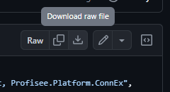
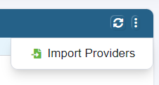

# Connectors
This repository contains the Profisee Connectors.

## Importing a Connector into Profisee
1. Find the connector you want to import (e.g. [Melissa Data Personator](Example%20Service%20Providers/Melissa%20Data%20Personator/Personator%20Consumer_v3.json))
2. Click the "download raw file" button

   
3. Find the downloaded file
4. Go to the Profisee Portal
5. Navigate to Administration > Connect > Service Providers
6. Click on the ellipsis in the top right of the grid and choose "Import Providers"
   
   
7. Select the file that you downloaded and click "Open"

## Connector Architecture Documentation
For a guide on how to create your own Connector, see the [Service Provider Documentation](Service%20Provider%20Documentation) folder:
- [REST Service Provider Documentation](Service%20Provider%20Documentation/REST%20Service%20Provider%20Documentation.md)
- [Script Service Provider Documentation](Service%20Provider%20Documentation/Script%20Service%20Provider%20Documentation.md)

Example providers you can import and build on are in [Example Service Providers](Example%20Service%20Providers). For Script providers, start with the [Script examples README](Example%20Service%20Providers/Script/README.md).

## License
This project is licensed under the [MIT license](LICENSE.TXT).
